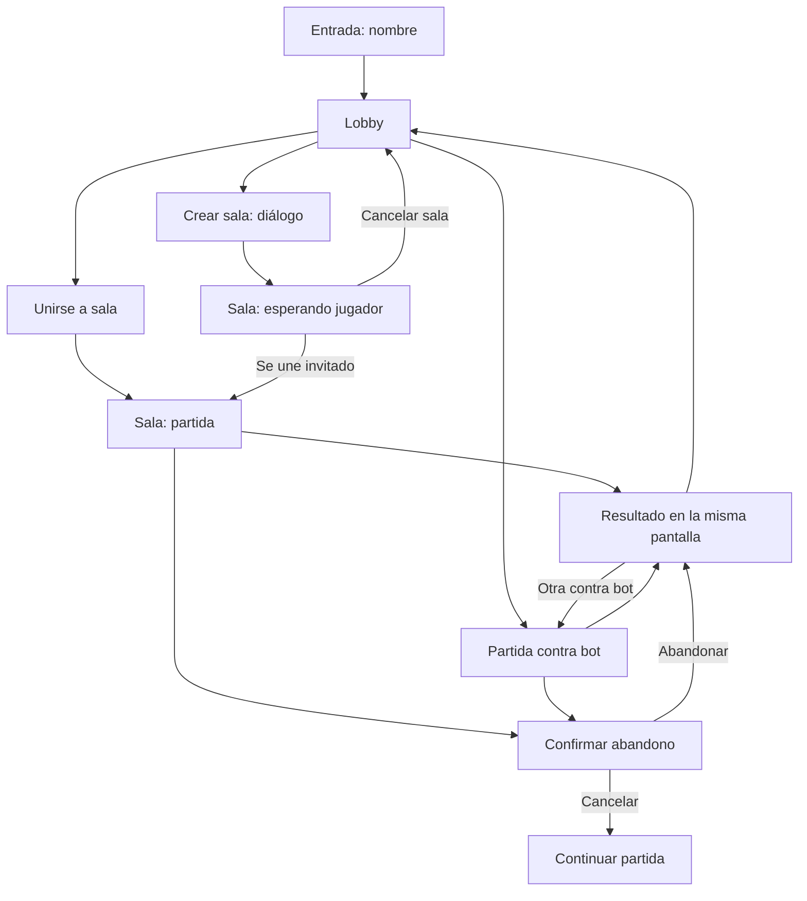
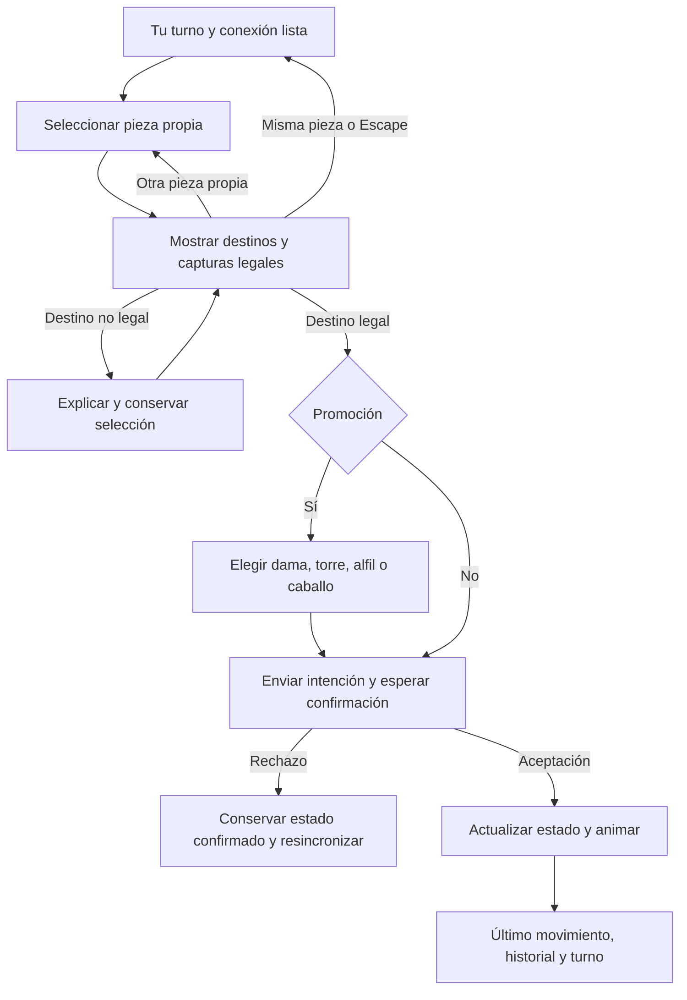

# 03 — Flujos de usuario

## Navegación principal

“Continuar partida” conserva la pantalla y el modo de origen. No es una pantalla adicional.

## Primera entrada y lobby

1. Abrir URL LAN; mostrar nombre y propósito breve.
2. Escribir nombre de 2–24 caracteres visibles, sin controles; recortar espacios externos.
3. Pulsar “Entrar”. Si falla, conservar nombre y permitir reintentar.
4. Ver lobby con “Crear sala” y “Jugar contra bot”. Si no hay salas, explicar que puede crear una.
5. Una sesión válida al recargar vuelve a su sala/partida activa, o al lobby si no tiene una.

## Crear y unirse

1. Anfitrión abre diálogo con nombre prellenado “Sala de {nombre}”, editable hasta 40 caracteres.
2. Crear muestra envío pendiente; cancelar cierra sin crear. Tras éxito, aparece sala esperando.
3. Otros ven nombre, anfitrión, “1/2 · Esperando” y “Unirse”.
4. Servidor acepta un único invitado de forma atómica. El siguiente recibe “La sala ya está completa” y lobby actualizado.
5. Inicia automáticamente: anfitrión blancas, invitado negras. Mostrar “Partida iniciada” y “Juegas con…”.
6. Cancelar sala antes de que se una alguien vuelve al lobby. Si la unión ganó la carrera, ya es partida y salir requiere abandono confirmado.

## Selección, movimiento y captura

La captura usa el mismo flujo: anillo en destino ocupado y descripción de pieza capturada. En captura al paso, el destino vacío lleva marcador de captura y se retira el peón correcto al confirmar.

## Espera, jaque y final

- Turno rival: tablero explorable, envío impedido, texto de espera; no mostrar un error por cada clic.
- Jaque: anunciar y marcar rey; solo ofrecer movimientos que resuelven jaque. No abrir un diálogo que interrumpa.
- Mate o tablas: bloquear nuevas jugadas, conservar tablero y mostrar resultado con motivo.
- Humano: “Nueva partida” vuelve al lobby para crear/unirse; “Volver al lobby” también permite explorar. No se reutiliza rival automáticamente.
- Bot: “Otra contra bot” crea partida nueva; “Volver al lobby” sale.
- Abandonar: confirmar “Perderás esta partida”; cancelar conserva juego. Confirmar produce resultado para ambos.

## Bot y errores

Desde lobby, “Jugar contra bot” inicia directamente con humano blancas. Tras cada movimiento confirmado, mostrar “Bot pensando…”. Mismo tablero, reglas, promoción y resultado que en humano.

Desconexión: bloquear envío, mostrar reintento y plazo de `09`. Recuperar sesión y snapshot antes de habilitar tablero. Si servidor reinició, informar que la partida no puede recuperarse y ofrecer volver a entrar. Una intención sin confirmación nunca se reenvía automáticamente.
