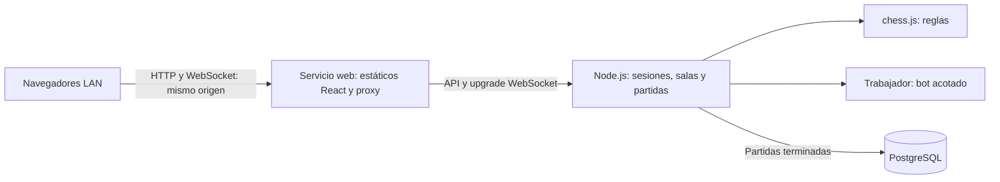

# 07 — Arquitectura mínima y ejecución LAN

Estado: propuesta de especificación; aprobación pendiente en `13`. No hay implementación ni versiones instaladas.

## Alternativas y elección

| Alternativa | Ventaja | Costo o limitación | Resolución propuesta |
|---|---|---|---|
| Solo navegador y memoria | Menos infraestructura | No satisface multijugador autoritativo ni PostgreSQL | Descartar |
| Un backend con memoria activa y archivo PostgreSQL | Límites claros y pocas piezas | Reinicio pierde partidas activas | Recomendada |
| Persistir cada comando y recuperar partidas tras caída | Más durabilidad | Transacciones por jugada y recuperación innecesarias para demo | Fuera de MVP |

Conservar stack previsto. No sustituirlo por preferencia personal.

## Responsabilidades

| Parte | Mantiene | No decide |
|---|---|---|
| React | Pantallas, foco, selección, diálogo de promoción, envío pendiente, snapshot confirmado y animación | Legalidad final, identidad rival o resultado |
| HTTP backend | Sesión temporal, lista/crear/unir/cancelar sala, iniciar bot, consultar snapshot y guardar resultado | Estado enviado arbitrariamente por cliente |
| WebSocket | Suscripción de lobby/partida, intenciones de movimiento/abandono, snapshots y errores | Reglas propias separadas de servicio de partida |
| Servicio de partida | Instancia de reglas, miembros, turnos, historial, revisión, resultado y conexión | Presentación visual |
| chess.js | Generación y validación legal, FEN, SAN y detección de estados soportados | Red, sesiones o IA |
| Bot | Calcular candidato sobre copia de posición y devolverlo con revisión | Mutar partida real o saltarse validación |
| PostgreSQL | Archivo de partidas terminadas e historial, transacción de finalización | Turno actual y transporte en tiempo real |
| Docker Compose | Arranque de web, backend y postgres; red y volumen local | Orquestación distribuida |

Backend monolítico pequeño: módulos de sesiones, salas, partidas, bot y persistencia. Sin repositorios genéricos, bus de eventos, ORM ni contenedor de inyección. Cliente recibe destinos legales del servidor con el snapshot; no necesita otra implementación de reglas. Esto reduce divergencias y dependencias frontend.

## Dependencias

- Proponer `chess.js` para reglas y `ws` para servidor WebSocket; documentación consultada vía Context7 el 2026-10-15.
- Navegador usa WebSocket nativo; `ws` no aporta reconexión automática de aplicación.
- React y herramientas de construcción se concretarán en fase 1 con versiones compatibles y lockfile.
- Framework HTTP, cliente PostgreSQL y herramientas de pruebas quedan pendientes de verificación documental en fase 1. Candidatos: Express y cliente SQL directo; no se prescribe sintaxis ni agrega dependencia ahora.
- No agregar librería de tablero o animación por defecto: cuadrícula semántica, piezas locales y CSS son suficientes. Revisar licencia de piezas antes de incorporarlas.

## Contratos HTTP conceptuales

| Operación | Resultado |
|---|---|
| Crear sesión con nombre | Cookie temporal y datos públicos de sesión |
| Consultar sesión | Identidad, sala/partida activa o necesidad de volver a entrar |
| Listar salas | Solo disponibles, con revisión del lobby |
| Crear sala | Sala propia esperando; repetición de solicitud no crea otra |
| Unirse | Admisión atómica y snapshot de partida, o sala llena/no disponible |
| Cancelar sala propia | Eliminación si todavía espera; conflicto si ya comenzó |
| Crear partida bot | Partida privada e instantánea inicial |
| Obtener partida activa | Snapshot autorizado para recuperación |

No son APIs de una librería. Rutas y tipos exactos se fijan dentro de la fase correspondiente, conservando estas responsabilidades. HTTP y WebSocket llaman al mismo servicio; no duplicar validación.

## Identidad temporal

Nombre público separado de ID aleatorio secreto de sesión. Cookie HttpOnly del mismo origen, SameSite y sin token en URL. La sesión vive en memoria; cierre de navegador no garantiza abandono inmediato, por eso existe plazo de gracia. Expirar sesiones inactivas sin partida tras 2 horas; una sesión con partida no expira por inactividad de movimientos. Tras terminar y volver al lobby se vuelve a contar inactividad. Una conexión controladora por sesión: una segunda pestaña reemplaza la anterior y muestra aviso en ella. Pruebas de dos jugadores usan contextos de navegador separados.

## Red local y Compose

- Servicios propuestos: `web`, `backend`, `postgres`. Solo `web` publica puerto 8080 del equipo anfitrión; servicio estático/proxy sencillo, sin plataforma de hosting.
- `web` entrega React y reenvía `/api` y `/ws` al backend por red interna, incluyendo upgrade WebSocket y tiempos de conexión adecuados.
- Backend escucha en `0.0.0.0` dentro de contenedor. `postgres:5432` y `backend:<puerto interno definido en fase 1>` son nombres internos, no direcciones para el navegador.
- Otros equipos abren `http://<IPv4-LAN-del-anfitrión>:8080`. `localhost` en otro equipo apunta a ese otro equipo, no al servidor.
- Cliente deriva HTTP y WebSocket de la ubicación actual: mismo host/puerto, `ws` bajo HTTP y `wss` bajo HTTPS. No fijar localhost ni IP de Docker en bundle.
- Mismo origen evita configuración CORS innecesaria. Validar Origin HTTP/WebSocket contra origen LAN configurado; CORS no protege por sí solo el upgrade WebSocket.
- Publicar puerto hacia LAN, no solo `127.0.0.1`; habilitar firewall de Windows únicamente para puerto de demo y perfil privado. Comprobar misma red y aislamiento de clientes del Wi-Fi.
- PostgreSQL sin puerto publicado por defecto, con volumen nombrado y credenciales locales fuera del repositorio.
- Demo reproducible en Compose. Desarrollo fuera de contenedor es opcional; usar proxy de desarrollo del mismo origen si se elige y documentarlo entonces.
- Arranque debe esperar disponibilidad real de PostgreSQL; orden de servicios no basta. Fallo de base de datos informa estado, sin bloquear lectura de resultado ya confirmado.

## Fuentes consultadas

- [chess.js](https://github.com/jhlywa/chess.js): reglas e historial, no IA.
- [ws](https://github.com/websockets/ws): integración HTTP upgrade y heartbeat.
- [Docker: networking en Compose](https://docs.docker.com/compose/how-tos/networking/): nombres internos y puertos.
- [Docker: publicar puertos](https://docs.docker.com/get-started/docker-concepts/running-containers/publishing-ports/): exposición al host.

No se escriben Dockerfiles, manifiestos, endpoints ni código durante fase 0.
